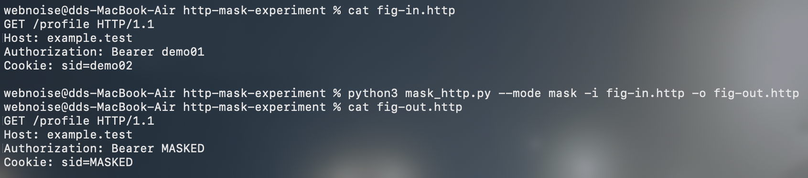

# HTTP Mask

A Python CLI for masking or removing `Authorization`, `Cookie`, and `Set-Cookie` in bodyless HTTP/1.1 requests and responses.



## Run

Requires Python 3.10+ and uses only the standard library.

```sh
python3 mask_http.py --mode mask -i examples/request.http
python3 mask_http.py --mode remove -i examples/request.http
```

End the input with a blank line. Use `-o` to save the output to a file.

## Tests and experiment

```sh
python3 -m unittest discover -s tests
python3 run_experiment.py
```

The experiment compares both modes against synthetic fixtures and writes its report to `results/`.
